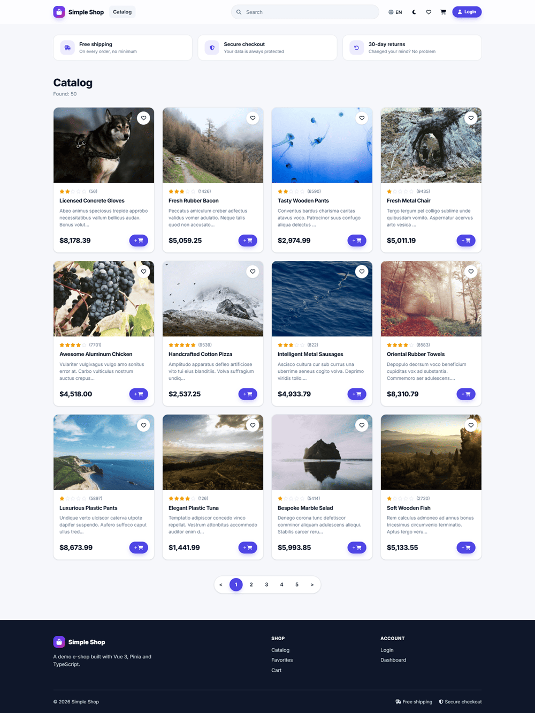

# vue-nuxt-simple-eshop

A simple demo e-shop built with **Nuxt 3**, **Pinia**, and **TypeScript**. The project includes a product showcase, shopping cart, favorites list, checkout, and an admin panel for content management. Pages are rendered on the server (SSR).

[](git/origin/main-page.png)

Click the image to open the [full-size screenshot](git/origin/main-page.png).

## ✨ Key Features

### Showcase and Products
*   **Product Catalog**: View the list of available products with images, ratings, descriptions, and prices.
*   **Search**: Quickly find products by name.
*   **Pagination**: Easy navigation through a large number of products.
*   **Detail Page**: Detailed information about each product.

### Shopping and Favorites
*   **Shopping Cart**: Add products, manage quantities, remove items.
*   **Favorites**: Save your favorite products to a separate list.
*   **Checkout**: A full checkout form with data validation and an order summary.

### Admin Panel
*   **Product Management**: Create, edit (with a live preview), and delete products from the catalog.
*   **Order Management**: View incoming orders and mark them as processed.
*   **Authorization**: Login to the admin panel using JWT (token lifetime 1 hour, stored in a cookie and verified by the API on every admin route, also during SSR).

### Miscellaneous
*   **Server-Side Rendering**: Catalog, product pages and the admin panel are rendered by Nuxt on the server.
*   **Light / Dark Theme**: Follows the system preference by default, the choice is remembered.
*   **Localization (I18n)**: Support for Russian and English languages (RU/EN).
*   **Responsiveness**: Bootstrap 5-based interface displays correctly on various devices.

---

## 🛠 Technology Stack

*   **Framework**: [Nuxt 3](https://nuxt.com/) (Vue 3 Composition API, SSR)
*   **State Management**: [Pinia](https://pinia.vuejs.org/)
*   **Language**: [TypeScript](https://www.typescriptlang.org/)
*   **Styling**: [Bootstrap 5](https://getbootstrap.com/), [SCSS](https://sass-lang.com/), [Font Awesome 6](https://fontawesome.com/)
*   **Validation**: [Vuelidate](https://vuelidate-next.netlify.app/)
*   **HTTP Client**: [Axios](https://axios-http.com/)
*   **Backend Simulation**: [json-server](https://github.com/typicode/json-server) + JWT Auth Middleware

---

## 🚀 Quick Start

**Node.js** (version 24+) or **Docker** is required to run the project.

Both options start everything with a single command: the API (json-server) and the Nuxt application run together, no separate terminals are needed.

After startup, the application will be available at `http://localhost:5111` and the API at `http://localhost:3555`.

### Option 1: Run via Docker

```bash
docker-compose up --build
```

The container installs the dependencies itself and starts the API and the Nuxt development server. The first start takes a few minutes (`npm install` + first build), the next ones are fast.

Source changes are picked up automatically (hot reload works inside the container). Stop it with `Ctrl+C` or `docker-compose down`.

### Option 2: Local Setup (npm)

```bash
npm install
npm run dev:all
```

`npm run json` and `npm run dev` can still be started separately if only one of them is needed.

### API URL

By default the application uses the API at `http://localhost:3555`. To use another API, set the `NUXT_PUBLIC_API_BASE` environment variable:

```bash
NUXT_PUBLIC_API_BASE=http://my-api-host:3555 npm run dev
```

---

## 📜 Available Scripts

*   `npm run dev:all` — starts the API (`json`) and the Nuxt development server (`dev`) together.
*   `npm run dev` — starts only the Nuxt development server.
*   `npm run json` — starts only `json-server` with the demo data (`data.js`: 50 generated products, the same as in vue-simple-eshop).
*   `npm run dev:host` — starts the Nuxt development server reachable from other hosts (`0.0.0.0`).
*   `npm run docker:start` — installs dependencies and starts `json` and `dev:host` together (used by Docker).
*   `npm run build` — builds the project for production.
*   `npm run preview` — locally preview the production build.
*   `npm run generate` — static site generation.
*   `npm run typecheck` — TypeScript check of the whole project (vue-tsc).
*   `npm run lint` — checks and fixes code formatting issues via ESLint.

---

## 🔒 Admin Credentials

Default credentials: `admin` / `admin`. They (and the JWT secret) can be overridden with the `ADMIN_USERNAME`, `ADMIN_PASSWORD` and `APP_SECRET` environment variables of `npm run json`.

Without a token, the API allows only reading products and placing orders; managing products and viewing or changing orders requires the admin token. Order prices are always taken from the product database, not from the client.

---

Developed as a demo project to explore the capabilities of Nuxt 3 and Pinia.
